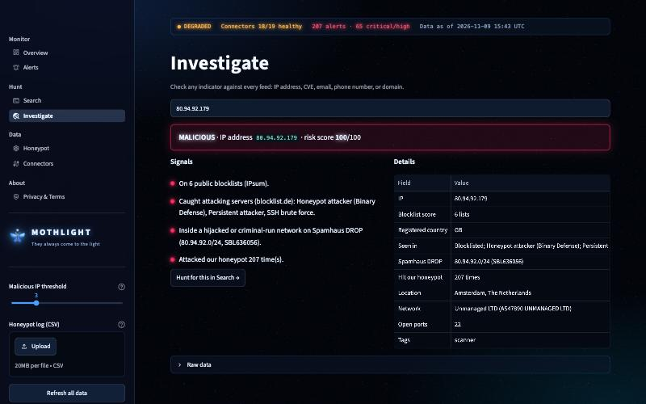
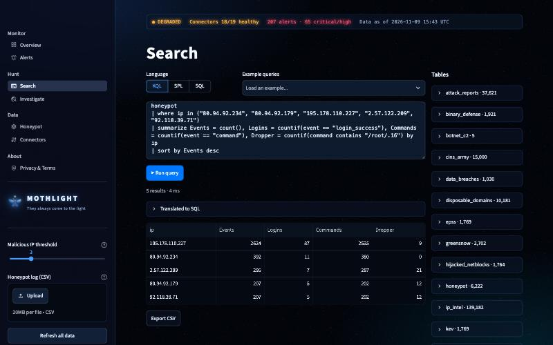

# INC-2026-1109-01: SSH Botnet Campaign With Honeypot Evasion and a Hidden Payload

This is a SOC-style write-up of a real attack on the Mothlight honeypot. I investigated it on my own, start to finish, using [Mothlight](https://mothlight.streamlit.app), the open-source SIEM my team built.

| | |
| --- | --- |
| Incident ID | INC-2026-1109-01 |
| Date | November 9, 2026, 02:48 to 15:45 UTC |
| Severity | High (it would have been Critical on a real server) |
| Status | Closed. The target was a honeypot, so nothing real was affected. |
| SIEM | [Mothlight](https://github.com/realzephaniahjohnson/mothlight) |
| Data source | The Mothlight Cowrie SSH honeypot on Oracle Cloud in Montreal, through [mothlight-honeypot-data](https://github.com/realzephaniahjohnson/mothlight-honeypot-data) |
| Analyst | Zephaniah Johnson |

## 1. Summary

Over 13 hours, five IP addresses took turns attacking the SSH honeypot. They went one after another and never overlapped. Between them they opened 119 sessions and ran 3,606 commands.

They all followed the same routine. Log in as root with a weak password, run a script to check whether the machine is a honeypot, and then, in 18 of those sessions, try to make a hidden file called `/root/.16` executable. To do that they fed the password they'd just guessed straight into `sudo`.

All five IPs live in networks that Spamhaus lists as hijacked or criminal-run, and Mothlight raised a High alert on every one of them. I believe this was one botnet operator working through a list of targets, not five different attackers.

## 2. Detection

Mothlight's "Known-bad IP attacked honeypot" rule fired once for each IP. It's a High-severity rule that goes off when an IP that's already on 5 or more public blocklists hits the honeypot.

| Alert time (UTC) | Rule | Entity | Alert details |
| --- | --- | --- | --- |
| 03:27 | Known-bad IP attacked honeypot | 80.94.92.234 | 392 attempts, on 7 blocklists |
| 04:49 | Known-bad IP attacked honeypot | 80.94.92.179 | 207 attempts, on 6 blocklists |
| 07:16 | Known-bad IP attacked honeypot | 195.178.110.227 | 2,624 attempts, on 8 blocklists |
| 08:21 | Known-bad IP attacked honeypot | 2.57.122.209 | 295 attempts, on 7 blocklists |
| 15:39 | Known-bad IP attacked honeypot | 92.118.39.71 | 84 attempts when it fired (207 by the end) |

`2.57.122.209` and `92.118.39.71` also set off the Medium "Multi-vector attacker" rule from blocklist.de data. And `195.178.110.0/24` was already on Mothlight's list of the day's top 20 attacking networks from SANS DShield.

Something I noticed right away: these alerts fired because of who the IPs were, not because of what they did. Nothing alerted on the dropper itself. I come back to that in section 8.

## 3. Triage and enrichment

I ran each IP through Mothlight's Investigate page, and all five came back as malicious with a risk score of 100 out of 100.



| IP | Blocklists (IPsum) | Spamhaus DROP network | Other reputation | Honeypot events | Sessions | Active (UTC) |
| --- | --- | --- | --- | --- | --- | --- |
| 80.94.92.234 | 7 | 80.94.92.0/24 (SBL636056) | Binary Defense honeypot attacker, persistent attacker, SSH brute force | 392 | 12 | 02:48 to 03:27 |
| 80.94.92.179 | 6 | 80.94.92.0/24 (SBL636056) | Same as above; located in Amsterdam on AS47890 (Unmanaged LTD) | 207 | 5 | 04:36 to 04:49 |
| 195.178.110.227 | 8 | 195.178.110.0/24 (SBL677468) | GreenSnow brute force; its network was in DShield's top 20 that day (337 targets) | 2,624 | 89 | 05:14 to 07:16 |
| 2.57.122.209 | 7 | 2.57.122.0/24 (SBL636050) | GreenSnow brute force, Binary Defense, persistent attacker | 295 | 8 | 08:06 to 08:21 |
| 92.118.39.71 | 7 | 92.118.39.0/24 (SBL636057) | GreenSnow brute force, Binary Defense, persistent attacker | 207 | 5 | 15:36 to 15:45 |

Spamhaus DROP ("Don't Route Or Peer") only lists networks that have been hijacked or are run entirely by criminals. Seeing all five attackers come out of four DROP networks was one of the first things that made me think this was a single operation.

Mothlight's feeds also had other IPs from those same networks on blocklists that day, even though they never touched the honeypot: `80.94.92.55`, `195.178.110.26`, `195.178.110.228`, `195.178.110.232`, `2.57.122.168`, `2.57.122.238` and `92.118.39.49`.

## 4. Investigation

### Timeline

```mermaid
gantt
    title Campaign activity on Nov 9, 2026 (UTC)
    dateFormat HH:mm
    axisFormat %H:%M
    section Recon
    80.94.92.234 checks only   :a1, 02:48, 39m
    section Dropper
    80.94.92.179               :a2, 04:36, 13m
    195.178.110.227            :a3, 05:14, 122m
    2.57.122.209               :a4, 08:06, 16m
    92.118.39.71               :a5, 15:36, 9m
```



The IPs hand off to each other cleanly. The first one, `80.94.92.234`, only ran the honeypot checks. Every IP after that ran the checks and then the dropper at least once.

### Walking through one session

Session `6405c0945163` from `80.94.92.179` is a good example of the whole routine. The full log is in [`evidence/`](evidence/session-6405c0945163-80.94.92.179.txt).

1. **04:39:04.** It logs in as `root` with the password `111111`. Cowrie lets it in on purpose so the attacker's next moves get recorded.
2. **04:39:06 to 04:39:17.** It runs the honeypot-check script. That includes math like `$((825*469+...))`, printing its own process ID with `$$`, reading `/proc/self/stat` and `/proc/self/status`, and testing how subshells, arguments, functions and pipes behave. A real Linux shell gets all of that right, but an emulated one can slip up.
3. **04:39:17 to 04:40:53.** Nothing gets logged for 96 seconds. All 18 dropper sessions have a quiet gap like this, somewhere between 53 and 132 seconds. The export doesn't record file transfers, so my best guess is that this is when `/root/.16` got uploaded.
4. **04:40:53.** It tries every way it can think of to make the hidden file executable:

```bash
echo '111111' | sudo -S sh -c 'chmod +x '\''/root/.16'\''' || echo '111111' | sudo -S chmod +x '/root/.16' || sh -c 'chmod +x '\''/root/.16'\''' || chmod +x '/root/.16'
```

5. Then it disconnects. Start to finish, about 2 minutes.

### Why I think it's one operator

A few things line up across all five IPs:

- 114 of the 119 sessions ran the same check script, and it always prints markers in the same format: `check_<32 hex characters>_small_control` and `..._transport_done`.
- All 18 dropper sessions used the exact same `sudo -S` chain and the same file path, `/root/.16`.
- In all 18, the password fed into `sudo` was the exact one the bot had just logged in with. That's built into the tool, not something a person was typing.
- The timing barely changes. The first command lands 1 to 4 seconds after login, and the `chmod` lands 65 to 147 seconds after login.
- The same passwords keep showing up across different IPs, like `111111`, `123123`, `123321`, `1234`, `12345678` and `!root`.
- The IPs never overlap, which looks like one controller rotating to a fresh IP.
- Every IP sits in a Spamhaus DROP network.

The `!root` password caught my eye. In Cowrie's default user file, `!root` is how you say "reject the password root." Trying the literal string `!root` suggests whoever built this password list had been reading Cowrie's own config. I can't prove that, but it fits a toolkit that's clearly built to spot honeypots.

### Scope and impact

Only one system was hit, and it was the honeypot. It's a fake shell, so nothing the attackers ran ever touched a real machine.

I don't have the `/root/.16` file itself. The export doesn't save uploaded files yet, which is probably what happened during that quiet gap, and it cuts commands off at 200 characters. So I can't say for sure what the payload does. Going by the setup, it's most likely a botnet agent or a crypto miner.

No real credentials were exposed either. The real admin login on the VM is only reachable over Tailscale, and nothing ever touched it.

## 5. MITRE ATT&CK

| Tactic | Technique | ID | What I saw |
| --- | --- | --- | --- |
| Credential Access | Brute Force: Password Guessing | [T1110.001](https://attack.mitre.org/techniques/T1110/001/) | Root logins with weak passwords from a shared list |
| Initial Access | Valid Accounts: Default Accounts | [T1078.001](https://attack.mitre.org/techniques/T1078/001/) | Every session logged in as `root` |
| Defense Evasion | Virtualization/Sandbox Evasion: System Checks | [T1497.001](https://attack.mitre.org/techniques/T1497/001/) | Math, PID and `/proc/self` checks before any payload |
| Execution | Command and Scripting Interpreter: Unix Shell | [T1059.004](https://attack.mitre.org/techniques/T1059/004/) | 3,606 commands, most wrapped in `sh -c` |
| Privilege Escalation | Abuse Elevation Control Mechanism: Sudo | [T1548.003](https://attack.mitre.org/techniques/T1548/003/) | `echo '<password>' \| sudo -S ...` in 18 sessions |
| Defense Evasion | File and Directory Permissions Modification: Linux | [T1222.002](https://attack.mitre.org/techniques/T1222/002/) | `chmod +x '/root/.16'` |
| Defense Evasion | Hide Artifacts: Hidden Files and Directories | [T1564.001](https://attack.mitre.org/techniques/T1564/001/) | Payload stored as the dot-file `/root/.16` |

## 6. Indicators of compromise

The full list is in [`iocs.csv`](iocs.csv). The short version:

- IPs: `80.94.92.234`, `80.94.92.179`, `195.178.110.227`, `2.57.122.209`, `92.118.39.71`
- Networks: `80.94.92.0/24`, `195.178.110.0/24`, `2.57.122.0/24`, `92.118.39.0/24`
- File: `/root/.16`
- Behavior: `echo '<password>' | sudo -S sh -c 'chmod +x ...'` right after an SSH login
- Script markers: `check_<32 hex>_small_control` and `check_<32 hex>_transport_done`

## 7. Response and recommendations

There's nothing to clean up on the honeypot since the shell is fake. If this had been a real server, here's what I would have done.

To contain it, I'd block all four networks at the firewall. They're on Spamhaus DROP, so it's very unlikely anything legitimate comes from them. If the `chmod` had actually worked, I'd also pull the server off the network so the payload couldn't call home.

To clean it up, I'd look for `/root/.16`, any other dot-files in `/root` and `/tmp`, and anything unfamiliar in running processes, cron jobs and `authorized_keys`. Then I'd rotate the root password and any other credentials stored on the box.

To keep it from happening again:

- Turn off password logins for SSH and only allow keys.
- Set `PermitRootLogin no`.
- Put admin access behind a VPN like Tailscale, the same way the honeypot's real login is set up.
- Rate-limit SSH with something like fail2ban.

## 8. Detection gaps and what I learned

Mothlight only alerted on reputation, not on behavior. Every IP got flagged because it was already on blocklists, which means a brand-new IP running the exact same attack would have slipped right past it. To fix that, I wrote two behavior-based rules for Mothlight: one for hidden files being made executable, and one for passwords being piped into `sudo`. Both are in [`queries/hunting-queries.md`](queries/hunting-queries.md), and on this data they catch all 18 dropper sessions without a single false positive.

Mothlight's alerts also fire late. Mothlight timestamps the alert at the IP's latest activity, so the alert for `92.118.39.71` showed 84 attempts while the IP kept going until it hit 207. Ideally a rule would fire on the first malicious command instead.

I missed the payload. Next time I want to save uploaded files and keep the full command text, so I can actually say what the malware does.

Hunting on the toolkit worked better than hunting on IPs. One query for the check-script markers found every IP in the campaign, and it'll keep working after the operator switches to new IPs.

## Evidence

| File | What it is |
| --- | --- |
| [`evidence/campaign-events.csv`](evidence/campaign-events.csv) | All 3,725 honeypot events from the five campaign IPs |
| [`evidence/session-6405c0945163-80.94.92.179.txt`](evidence/session-6405c0945163-80.94.92.179.txt) | The full session from section 4 |
| [`iocs.csv`](iocs.csv) | Indicators of compromise |
| [`queries/hunting-queries.md`](queries/hunting-queries.md) | The KQL and SPL I used, plus the two new detection rules |
| [`screenshots/`](screenshots/) | Mothlight's Investigate and Search pages |



---

Investigated by Zephaniah Johnson using [Mothlight](https://github.com/realzephaniahjohnson/mothlight), the SIEM built by Zephaniah Johnson, Zakari Gilmer and Bofelo Gaeonale.
